# 📄 RAPPORT DE STAGE

**Diplôme** : Ingénierie des Logiciels et Intelligence Artificielle  
**Département** : Informatique  
**Établissement** : ENSA Fès  
**Entreprise d’accueil** : CAD Digital Agency  

---

## 📑 TABLE DES MATIÈRES

1. [PAGE DE GARDE ET REMERCIEMENTS](#-page-de-garde-et-remerciements)
2. [RÉSUMÉ & ABSTRACT](#-résumé--abstract)
3. [GLOSSAIRE & DÉFINITIONS MÉTIER](#-glossaire--définitions-métier)
4. [CHAPITRE 1 : CONTEXTE GÉNÉRAL ET CADRE DU STAGE](#-chapitre-1--contexte-général-et-cadre-du-stage)
   - 1.1 Présentation de l'Entreprise d'Accueil (CAD Digital Agency)
   - 1.2 Contexte et Problématique du Projet
   - 1.3 Objectifs de la Plateforme SyndicApp
   - 1.4 Mission Réalisée, Rôle du Stagiaire et Planning de Réalisation (Gantt)
5. [CHAPITRE 2 : ANALYSE DES BESOINS ET CAHIER DES CHARGES](#-chapitre-2--analyse-des-besoins-et-cahier-des-charges)
   - 2.1 Analyse de l'Existant et Workflow Global (Diagramme d'Activité)
   - 2.2 Spécification des Besoins Fonctionnels
   - 2.3 Spécification des Besoins Non-Fonctionnels
6. [CHAPITRE 3 : ARCHITECTURE LOGICIELLE ET CONCEPTION](#-chapitre-3--architecture-logicielle-et-conception)
   - 3.1 Acteurs du Système et Diagramme de Cas d'Utilisation
   - 3.2 Stack Technologique, Architecture 3-Tiers, Composants & Déploiement Cloud
   - 3.3 Base de Données Cloud & Diagramme de Séquence Authentification RBAC
   - 3.4 Modèle Logique de Données (MLD / ERD Prisma)
   - 3.5 Modélisation Objet & Diagramme de Classe UML Détaillé
7. [CHAPITRE 4 : RÉALISATION TECHNIQUE ET MODULES DÉVELOPPÉS](#-chapitre-4--réalisation-technique-et-modules-développés)
   - 4.1 Site Vitrine et Module d'Authentification (RBAC)
   - 4.2 Tableau de Bord Administrateur (Espace Syndic)
   - 4.3 Modules Financiers, Ventilation des Dépenses & Cycle de Vie des Paiements
   - 4.4 Module de Consultation & Workflow des Sondages Successifs
   - 4.5 Module Communication, Annonces Anonymes & Messagerie Directe
8. [CONCLUSION ET PERSPECTIVES](#-conclusion-et-perspectives)

---

## 🎓 PAGE DE GARDE ET REMERCIEMENTS

### Remerciements

Avant d’entamer ce rapport, je tiens à exprimer ma profonde gratitude et mes sincères remerciements à toutes les personnes qui ont contribué au bon déroulement de mon stage et à l'élaboration de ce travail.

Je remercie tout d'abord **Mr. Nizar Benharbet**, Directeur de **CAD Digital Agency**, pour m'avoir ouvert les portes de l'entreprise et m'avoir offert l'opportunité d'intégrer une équipe dynamique et innovante.

Mes remerciements s'adressent tout particulièrement à mon responsable de stage pour sa confiance, son encadrement constant et ses précieux conseils techniques. Travailler sur des projets complexes utilisant la stack **Next.js**, **Prisma ORM** et **Neon Postgres** sous sa supervision a été une expérience extrêmement formatrice.

Je tiens également à exprimer ma reconnaissance envers le corps professoral de l'**ENSA Fès** pour son soutien pédagogique et la qualité des enseignements dispensés en Ingénierie des Logiciels.

Enfin, je remercie l'ensemble des collaborateurs de **CAD Digital Agency** pour leur accueil chaleureux, leur aide technique et l'esprit d'équipe stimulant qui règne au sein de l'agence.

---

## 📝 RÉSUMÉ & ABSTRACT

### Résumé (Français)
Le projet **SyndicApp** s'inscrit dans la digitalisation des processus de gestion de copropriété pour les syndics au Maroc. La plateforme centralise la gestion administrative et financière des immeubles en proposant deux espaces étanches : un espace administration (Syndic) et un espace résidentiel (Copropriétaires). Les fonctionnalités majeures incluent le suivi du budget prévisionnel (charges fixes/variables), l'enregistrement des dépenses exceptionnelles ventilées au prorata des quote-parts, la génération automatique des échéanciers mensuels de paiement, l'impression de reçus de caisse certifiés, ainsi qu'un module de sondages obligatoires enchaînés et une messagerie intégrée. Développée avec **Next.js App Router**, **TypeScript**, **Prisma ORM** et la base de données serverless cloud **Neon PostgreSQL**, l'application garantit sécurité, performance et scalabilité.

### Abstract (English)
The **SyndicApp** project aims to digitize condominium management processes for property managers in Morocco. The platform centralizes administrative and financial management by providing two distinct interfaces: a manager dashboard (Syndic) and a co-owner portal. Key features include annual budget planning (fixed vs. variable fees), emergency expense allocation based on ownership shares, automated monthly payment schedule generation, certified receipt printing, a mandatory sequential voting system, and an integrated messaging board. Built with **Next.js App Router**, **TypeScript**, **Prisma ORM**, and **Neon Serverless PostgreSQL**, the platform ensures high performance, security, and cloud scalability.

---

## 📖 GLOSSAIRE & DÉFINITIONS MÉTIER

1. **Syndic de Copropriété** : Mandataire légal désigné pour administrer l'immeuble, gérer la comptabilité, veiller à l'entretien des parties communes et exécuter les décisions des assemblées.
2. **Copropriétaire** : Personne physique ou morale propriétaire d'un lot privatif (bureau, appartement) détenant une fraction indivise des parties communes.
3. **Bureau / Lot** : Unité immobilière privative identifiée par un numéro, un étage, un titre foncier et des quote-parts d'occupation.
4. **Titre Foncier** : Numéro d'immatriculation juridique officiel délivré par la conservation foncière garantissant la propriété du bien.
5. **Quote-Part Privative** : Superficie exacte exclusive appartenant uniquement au propriétaire du lot.
6. **Quote-Part Commune (Tantièmes / Millièmes)** : Fraction indivise d'ownership sur les espaces partagés (ascenseur, couloirs, toit), servant de clé de répartition pour le calcul des charges.
7. **Budget Prévisionnel (Charges Fixes / Variables)** : Budget annuel estimé pour l'entretien courant (*Fixes* : gardiennage, ascenseur ; *Variables* : eau, électricité des communs).
8. **Dépenses Exceptionnelles** : Coûts d'intervention imprévus (réparations urgentes, toiture) répartis automatiquement entre les lots selon la quote-part commune.

---

## 🔤 LISTE DES ABRÉVIATIONS & ACRONYMES

| Abréviation | Signification Complète | Définition & Rôle dans le Projet |
|---|---|---|
| **AG** | Assemblée Générale | Réunion légale obligatoire réunissant tous les copropriétaires pour décider des budgets et travaux. |
| **API** | Application Programming Interface | Interface de programmation permettant l'échange de données entre le frontend et le backend. |
| **CDN** | Content Delivery Network | Réseau mondial de serveurs (Cloudflare Edge) distribuant rapidement les ressources du site web. |
| **CMI** | Centre Monétique Interbancaire | Organisme bancaire marocain agréé gérant la passerelle de paiement électronique par carte bancaire. |
| **CSRF** | Cross-Site Request Forgery | Attaque web contrecarrée par l'utilisation de cookies de session sécurisés avec le flag `SameSite=Lax`. |
| **CUID** | Collision-Resistant Unique Identifier | Identifiant unique universel généré par Prisma pour sécuriser les clés primaires en base de données. |
| **ERD** | Entity-Relationship Diagram | Diagramme entité-association modélisant la structure logique des 9 tables de la base de données Prisma. |
| **Gantt** | Diagramme de Gantt | Chronogramme graphique planifiant le déroulement des 5 phases majeures du projet sur la période de stage. |
| **HTTP / HTTPS** | HyperText Transfer Protocol (Secure) | Protocole de communication chiffré TLS entre le navigateur web de l'utilisateur et les API serverless. |
| **ILIA** | Ingénierie des Logiciels et IA | Filière de spécialisation d'ingénieur d'État à l'École Nationale des Sciences Appliquées (ENSA Fès). |
| **IoT** | Internet of Things | Internet des Objets connectés envisagé pour télé-relever les compteurs d'eau et d'électricité des communs. |
| **JSON** | JavaScript Object Notation | Format léger d'échange de données textuelles structurées entre les formulaires React et les API Routes. |
| **JWT** | JSON Web Token | Jeton cryptographique signé utilisé pour authentifier de manière sécurisée les sessions utilisateurs. |
| **KPI** | Key Performance Indicator | Indicateur clé de performance financière (taux de recouvrement, résultat net) affiché sur le tableau de bord. |
| **MLD** | Modèle Logique de Données | Représentation logique de la base de données relationnelle traduisant les entités, attributs et clés étrangères. |
| **OCR** | Optical Character Recognition | Reconnaissance optique de caractères envisagée pour numériser automatiquement les factures de dépenses réelles. |
| **ORM** | Object-Relational Mapping | Outil logiciel (Prisma ORM) permettant de manipuler la base de données PostgreSQL en TypeScript typé. |
| **PDF** | Portable Document Format | Format de document certifié généré par `jsPDF` pour les bilans annuels et les reçus de caisse officiels. |
| **PWA** | Progressive Web App | Application web évolutive pouvant s'installer sur smartphone et fonctionner comme une application native. |
| **RBAC** | Role-Based Access Control | Contrôle d'accès basé sur les rôles assurant un cloisonnement strict entre Syndic et Copropriétaire. |
| **SaaS** | Software as a Service | Modèle de distribution d'application logicielle hébergée sur le Cloud et accessible via navigateur web. |
| **SQL** | Structured Query Language | Langage standard de requêtes utilisé par PostgreSQL pour la manipulation des données relationnelles. |
| **SSR / SSG** | Server-Side Rendering / Static Gen | Modes de rendu optimisés du framework Next.js garantissant rapidité d'affichage et performance SEO. |
| **UML** | Unified Modeling Language | Langage de modélisation visuelle (Cas d'Utilisation, Activité, Séquence, Classe) utilisé pour concevoir le système. |
| **XSS** | Cross-Site Scripting | Injection de scripts malveillants bloquée par l'encapsulation des jetons de session dans des cookies `HttpOnly`. |

---

## 🟦 CHAPITRE 1 : CONTEXTE GÉNÉRAL ET CADRE DU STAGE

### 1.1 Présentation de l'Entreprise d'Accueil (CAD Digital Agency)

#### 1.1.1 Présentation Générale

**CAD Digital Agency** est une entreprise marocaine fondée et dirigée par **M. Nizar Benharbit Alami**, Fondateur et Directeur Général. L'entreprise développe ses activités dans plusieurs domaines, notamment le digital, la communication, la formation professionnelle, l'immobilier ainsi que la commercialisation de matériaux de construction.

La création de CAD Digital Agency est le fruit de l'expérience professionnelle de son fondateur, qui dispose de **plus de 20 ans d'expérience** dans les domaines du bâtiment, de la construction et de l'aménagement. Cette expérience, associée à son intérêt pour le domaine du digital et aux évolutions technologiques, a contribué à la création de l'entreprise et au développement de ses différentes activités.

#### 1.1.2 Domaines d'Activité

##### Le Digital et la Communication

Dans le domaine du digital, CAD Digital Agency accompagne les entreprises et les professionnels dans le développement de leur présence numérique, notamment à travers :
- La communication digitale et la création de contenu
- Le marketing digital
- La conception de solutions web
- L'accompagnement des projets digitaux

##### La Formation Professionnelle

L'entreprise développe également des activités de formation professionnelle, avec des formations orientées vers différents métiers et compétences répondant aux besoins et aux évolutions du marché de l'emploi.

##### L'Immobilier et les Matériaux de Construction

Par ailleurs, CAD Digital Agency développe des activités dans le secteur de l'immobilier. En complément, l'entreprise assure également la commercialisation de produits et matériaux de construction, une activité qui s'inscrit dans la continuité de l'expérience de son fondateur dans le domaine du bâtiment et de l'aménagement.

#### 1.1.3 Organisation Administrative

Sur le plan administratif, **Mme Imane Idrissi**, Responsable Administrative, assure notamment le suivi des opérations administratives, des documents et contrats, des communications ainsi que l'organisation et le suivi administratif de l'entreprise.

#### 1.1.4 Fiche Signalétique

| Élément | Détail |
|---|---|
| **Raison sociale** | CAD Digital Agency |
| **Fondateur & Directeur Général** | M. Nizar Benharbit Alami |
| **Responsable Administrative** | Mme Imane Idrissi |
| **Secteurs d'activité** | Digital, Communication, Formation, Immobilier, Matériaux de construction |
| **Pays** | Maroc |

Ainsi, CAD Digital Agency se caractérise par une diversification de ses activités, avec une volonté de développer des services complémentaires et de s'adapter aux besoins du marché.

---

### 1.2 Contexte et Problématique du Projet

#### 1.2.1 Contexte Général de la Copropriété au Maroc

Au Maroc, l'urbanisation rapide et le développement des complexes résidentiels et tertiaires ont entraîné une augmentation significative du nombre d'immeubles régis par le régime de la copropriété (encadré par la Loi 18-00 modifiée par la Loi 106-12). La gestion des parties communes et des finances de l'immeuble est traditionnellement confiée à un Syndic de copropriété (bénévole ou professionnel). Cependant, la majorité des syndics utilisent encore des méthodes traditionnelles (cahiers papier, tableaux Excel disjoints, encaissements informels) qui montrent aujourd'hui leurs limites face aux exigences modernes de gestion.

#### 1.2.2 Problématique et Obstacles Métiers

L'analyse de l'écosystème de gestion de copropriété fait ressortir quatre problématiques majeures :

1. **Manque de Transparence Financière et Défiance** :
   Les copropriétaires manquent de visibilité sur l'utilisation réelle de leurs cotisations. L'absence de bilans comptables clairs, de justificatifs numérisés et de reçus systématiques génère de la défiance et freine la dynamique de paiement.

2. **Taux d'Impayés Élevé et Recouvrement Inefficace** :
   En l'absence d'outils automatisés de relance et de suivi en temps réel des échéanciers mensuels, le syndic accumule des retards de paiement considérables, compromettant le règlement des charges courantes (électricité des communs, gardiennage, ascenseur).

3. **Lourdeur Administrative et Erreurs de Calcul** :
   La répartition manuelle des dépenses imprévues (travaux urgents, réparations) au prorata des quote-parts privatives et communes (tantièmes) de chaque lot est une tâche complexe et sujette aux erreurs de calcul.

4. **Blocage des Prises de Décision** :
   La faible participation physique des copropriétaires aux Assemblées Générales (AG) ralentit l'adoption de résolutions cruciales pour la maintenance et la rénovation des bâtiments.

#### 1.2.3 Nécessité d'une Solution Digitale

Pour surmonter ces contraintes, l'adoption d'une plateforme Web moderne, accessible 24/7 sur tout type d'appareil, s'impose comme une nécessité stratégique pour moderniser la relation Syndic-Copropriétaires.

---

### 1.3 Objectifs de la Plateforme SyndicApp

La plateforme **SyndicApp** a été conçue pour apporter une réponse technologique complète et intuitive aux problématiques identifiées.

#### 1.3.1 Objectifs Généraux

- Centraliser l'ensemble des données administratives et financières de la copropriété au sein d'une base de données unique et sécurisée dans le Cloud.
- Offrir deux interfaces étanches et adaptées aux rôles de l'utilisateur : un espace d'administration pour le Syndic et un espace de consultation/interaction pour le Copropriétaire.

#### 1.3.2 Objectifs Spécifiques et Fonctionnels

| Domaine | Objectif Spécifique |
|---|---|
| **Comptabilité & Budget** | Automatisations de la création du budget prévisionnel (charges fixes et variables) et calcul instantané de la quote-part de chaque lot. |
| **Recouvrement & Reçus** | Génération automatique des 12 échéances mensuelles par lot, suivi des règlements et émission de reçus certifiés téléchargeables en PDF. |
| **Prise de Décision** | Mise en place d'un système de sondages obligatoires et bloquants pour garantir le vote de chaque copropriétaire avant accès à son espace. |
| **Communication** | Mur d'annonces publiques avec possibilité de publication anonyme et système de messagerie privée directe. |
| **Reporting & Transparence** | Génération automatique du rapport financier annuel en PDF avec graphiques de trésorerie et bilans consolidés. |

---

### 1.4 Mission Réalisée, Rôle du Stagiaire et Planning de Réalisation

#### 1.4.1 Rôle et Responsabilités du Stagiaire

En tant que stagiaire développeur full-stack au sein du pôle ingénierie logicielle de **CAD Digital Agency**, mon rôle a couvert l'ensemble des phases du projet :
- **Analyse et Conception** : Rédaction des spécifications fonctionnelles, modélisation des diagrammes UML et conception du modèle de données sous **Prisma ORM**.
- **Développement Frontend** : Création des composants UI réactifs et accessibles avec **Next.js App Router**, **React** et **Tailwind CSS**.
- **Développement Backend** : Implémentation des routes API serverless, gestion de l'authentification sécurisée (RBAC, JWT, bcryptJS) et intégration avec la base **Neon PostgreSQL**.
- **Qualité et Recette** : Réalisation des tests d'intégration, vérification du typage strict **TypeScript** et rédaction de la documentation technique.

#### 1.4.2 Méthodologie de Travail (Agile Scrum)

Le projet a été mené selon la méthodologie **Agile Scrum**, découpée en sprints de deux semaines. Chaque sprint intégrait des réunions de suivi avec le maître de stage afin de valider les fonctionnalités développées et d'ajuster le backlog produit.

#### 1.4.3 Planning et Chronogramme de Réalisation (Diagramme de Gantt)

Le chronogramme ci-dessous détaille le déroulement des 5 phases majeures du projet sur l'ensemble de la période de stage :

##### 📊 Diagramme 1.1 : Diagramme de Gantt (Planning et Chronogramme du Stage)
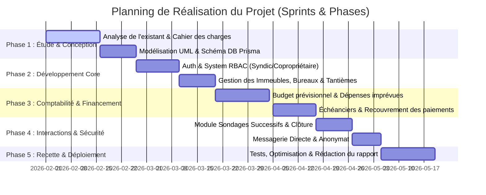

---

## 🟩 CHAPITRE 2 : ANALYSE DES BESOINS ET CAHIER DES CHARGES

### 2.1 Analyse de l'Existant et Workflow Global
L'analyse des pratiques existantes a révélé la nécessité de créer une solution centralisée basée sur le Web, accessible sans installation préalable et adaptée à tout type d'écran (PC, tablette, smartphone).

#### 🔄 Diagramme 2.1 : Diagramme d'Activité (Workflow Général de l'Application)
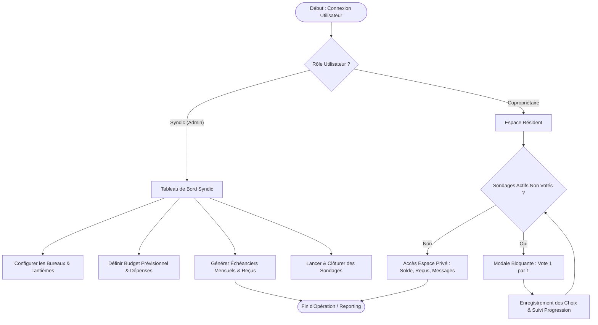

### 2.2 Spécification des Besoins Fonctionnels
- **Module Gestion des Membres & Lots** : Inscription des copropriétaires, création des fiches bureaux, attribution des quote-parts privatives et communes.
- **Module Gestion Financière** : Établissement du budget prévisionnel annuel, enregistrement des dépenses réelles, génération automatique des 12 échéances mensuelles par bureau.
- **Module Recouvrement & Reçus** : Suivi des statuts (*Payé*, *Impayé*, *Partiel*), saisie du montant réel perçu, impression de reçus certifiés.
- **Module Sondages & Consultations** : Création de votes par le syndic, réponse obligatoire enchaînée pour les copropriétaires, suivi en temps réel et option de clôture.
- **Module Communication** : Publication sur le mur d'annonces (avec mode anonyme) et messagerie privée directe.

### 2.3 Spécification des Besoins Non-Fonctionnels
- **Sécurité & Confidentialité** : Chiffrement des mots de passe avec `bcryptJS`, isolation stricte des données par rôle (RBAC) et jetons de session HttpOnly.
- **Performance & Scalabilité** : Temps de réponse rapides (< 200ms) grâce aux requêtes optimisées Prisma et à l'auto-scaling de Neon Postgres.
- **Maintenabilité & Robustesse** : Utilisation du langage **TypeScript** pour éliminer les erreurs de typage à la compilation.
- **Ergonomie & UX Modernisée** : Interface épurée avec composants Tailwind, absence d'émojis ou d'icônes obsolètes au profit d'icônes vectorielles SVG.

---

## 🟨 CHAPITRE 3 : ARCHITECTURE LOGICIELLE ET CONCEPTION

### 3.1 Acteurs du Système et Cas d'Utilisation

#### 👤 Diagramme 3.1 : Diagramme de Cas d'Utilisation (Use Case Diagram)
```mermaid
graph TD
    subgraph Acteurs
        S["🏢 Syndic (Administrateur)"]
        C["👤 Copropriétaire (Résident)"]
        V["🌐 Visiteur"]
    end

    subgraph Module Authentification
        CU_Auth["Connexion / Inscription"]
    end

    subgraph Module Gestion Copropriété
        CU_Bureau["Gérer les Bureaux & Quote-parts"]
        CU_Copro["Gérer les Comptes Copropriétaires"]
    end

    subgraph Module Gestion Financière
        CU_Budget["Planifier le Budget Prévisionnel"]
        CU_Depense["Saisir les Dépenses Exceptionnelles"]
        CU_Paiement["Valider les Paiements & Imprimer Reçus"]
        CU_Solde["Consulter l'Historique de ses Paiements"]
    end

    subgraph Module Communication & Votes
        CU_Comm["Publier sur le Mur d'Annonces"]
        CU_Msg["Messagerie Privée Directe"]
        CU_VoteAdmin["Créer & Clôturer les Sondages"]
        CU_VoteCopro["Répondre aux Sondages Successifs"]
    end

    V --> CU_Auth
    S --> CU_Auth
    S --> CU_Bureau
    S --> CU_Copro
    S --> CU_Budget
    S --> CU_Depense
    S --> CU_Paiement
    S --> CU_Comm
    S --> CU_Msg
    S --> CU_VoteAdmin

    C --> CU_Auth
    C --> CU_Solde
    C --> CU_Comm
    C --> CU_Msg
    C --> CU_VoteCopro
```

### 3.2 Stack Technologique, Architecture 3-Tiers, Composants & Déploiement

#### 🏗️ Diagramme 3.2 : Diagramme d'Architecture Technique 3-Tiers Cloud
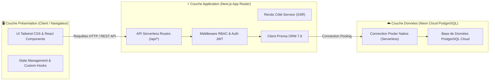

#### 🧩 Diagramme 3.3 : Diagramme de Composants Logiciels (Component Diagram)
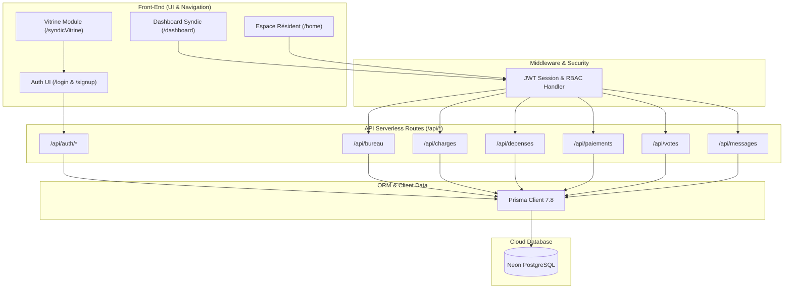

#### 🌐 Diagramme 3.4 : Diagramme de Déploiement Cloud (Deployment Diagram)
```mermaid
graph TD
    subgraph Users ["Client Devices"]
        Desktop["💻 PC / Mac Browser"]
        Mobile["📱 Smartphone / Tablet Browser"]
    end

    subgraph VercelEdge ["Vercel Global Edge Network"]
        CDN["Vercel CDN & Edge Middleware"]
        NodeRuntime["Next.js Serverless Engine (Node.js)"]
    end

    subgraph NeonCloud ["Neon Serverless Cloud (eu-central-1)"]
        Proxy["Neon Connection Pooler (PGBouncer)"]
        PrimaryNode["Postgres Compute Engine (Auto-scaling)"]
        StorageNode[("Neon Storage Engine (WAL / S3)")]
    end

    Desktop -->|HTTPS / SSL| CDN
    Mobile -->|HTTPS / SSL| CDN
    CDN --> NodeRuntime
    NodeRuntime -->|TCP / TLS (Pooled)| Proxy
    Proxy --> PrimaryNode
    PrimaryNode --- StorageNode
```

### 3.3 Base de Données Cloud & Diagramme de Séquence Authentification

#### 🔐 Diagramme 3.5 : Diagramme de Séquence - Authentification RBAC
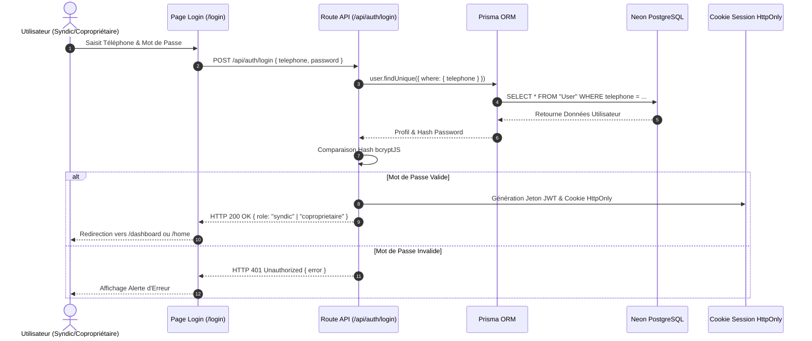

### 3.4 Modèle Logique de Données (MLD / ERD Prisma)

#### 🗄️ Diagramme 3.6 : Diagramme ERD (Modèle Entité-Association Prisma)
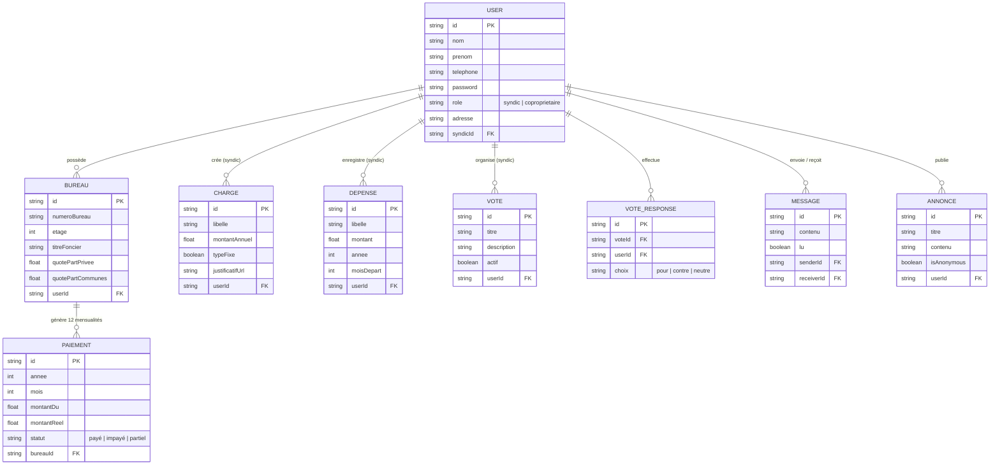

### 3.5 Modélisation Objet & Diagramme de Classe UML Détaillé

#### 📐 Diagramme 3.7 : Diagramme de Classe UML Détaillé
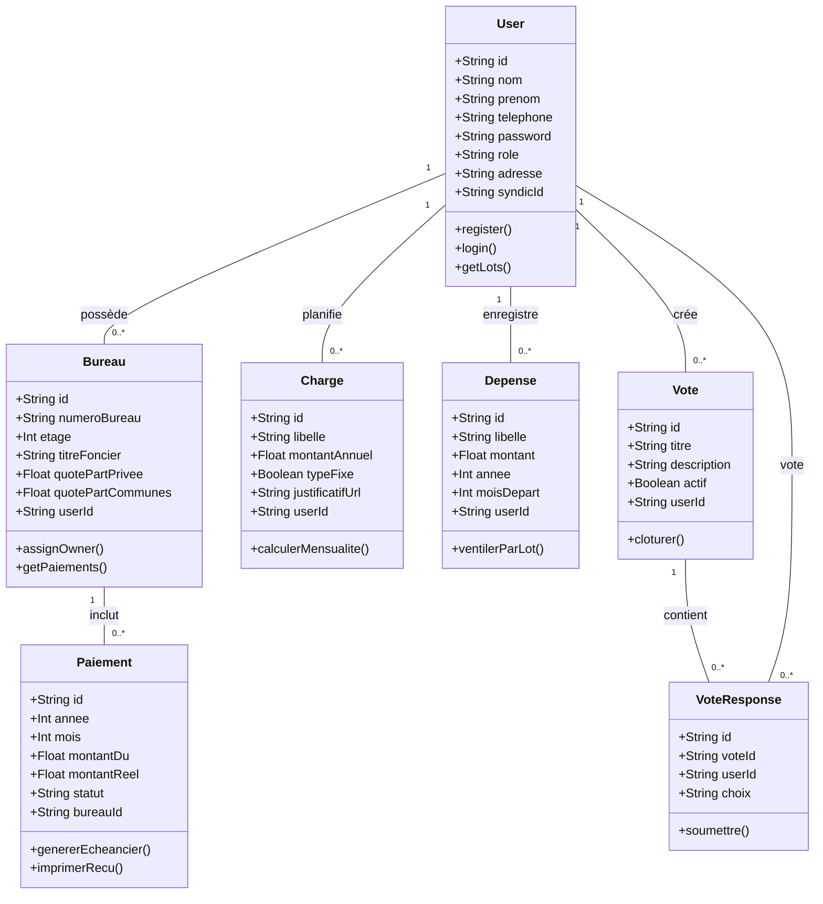

---

## 🟧 CHAPITRE 4 : RÉALISATION TECHNIQUE ET MODULES DÉVELOPPÉS

---

### 4.1 Site Vitrine et Module d'Authentification (RBAC)

#### 4.1.1 Site Vitrine (`src/app/syndicVitrine/page.tsx`)
Le site vitrine constitue la vitrine commerciale publique de la plateforme **SyndicApp**. Conçue avec Tailwind CSS, cette page présente de manière claire l'ensemble des modules de l'application.

#### 4.1.2 Module d'Authentification et Routage Dynamique par Rôle (`/login`, `/signup`, `/api/auth/*`)
Le module d'authentification assure un accès sécurisé et restreint selon le rôle de l'utilisateur.

---

### 4.2 Tableau de Bord Administrateur (Espace Syndic)

#### 4.2.1 Dashboard Principal (`src/app/dashboard/page.tsx`)
Le tableau de bord administrateur offre au syndic une vision synthétique et en temps réel de la santé financière et opérationnelle de la copropriété.

---

### 4.3 Modules Financiers & Comptabilité de Copropriété

#### 4.3.1 Gestion du Budget Prévisionnel (`src/app/dashboard/charges/page.tsx`)
Saisie des prévisions budgétaires avec distinction entre *Charges Fixes* et *Charges Variables*.

#### 4.3.2 Gestion des Dépenses Exceptionnelles & Calculator (`src/app/dashboard/depenses/page.tsx`)

#### 💰 Diagramme 4.1 : Diagramme de Séquence - Ventilation d'une Dépense Imprévue
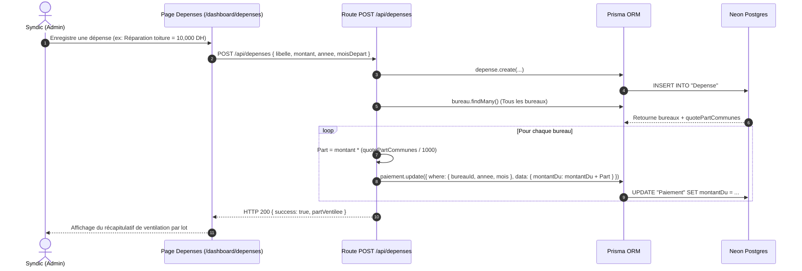

#### 4.3.3 Suivi des Paiements & Impression des Reçus (`src/app/dashboard/paiements/page.tsx`)

#### 🔄 Diagramme 4.2 : Diagramme d'État-Transition d'un Paiement Mensuel
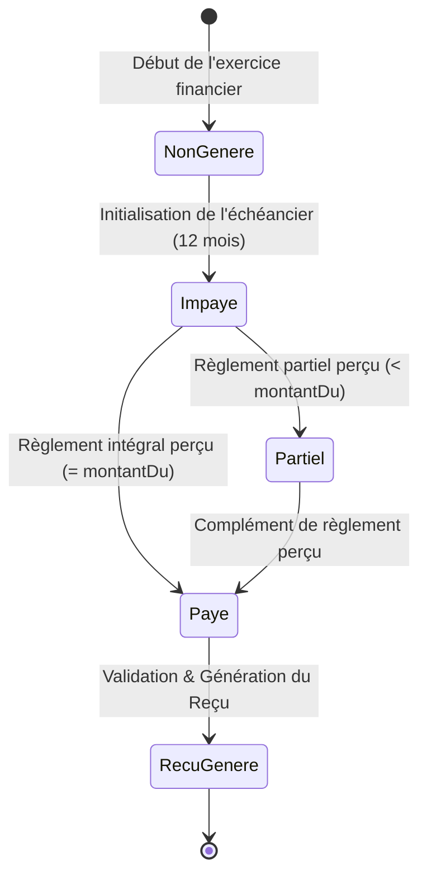

#### 🧾 Diagramme 4.3 : Diagramme d'Activité - Génération et Impression du Reçu de Caisse
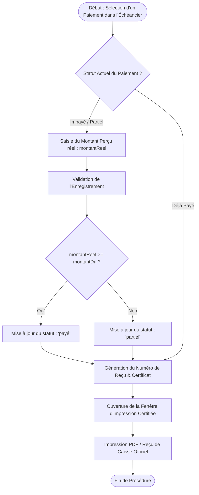

---

### 4.4 Module de Consultation & Sondages Successifs

#### 4.4.1 Workflow Copropriétaire (`src/app/home/page.tsx`)

#### 🔁 Diagramme 4.4 : Diagramme de Séquence - Workflow des Sondages Successifs
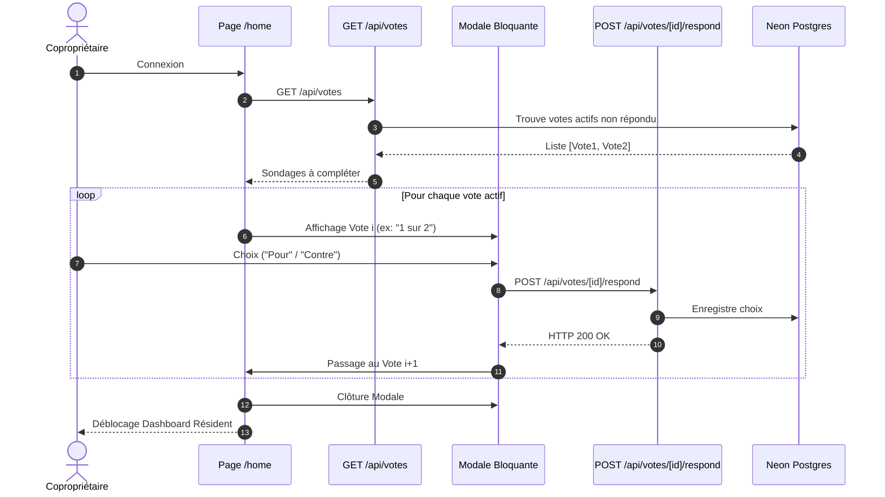

---

### 4.5 Module Communication & Messagerie Directe

#### 4.5.1 Mur d'Annonces & Messagerie Directe (`src/app/dashboard/communication/page.tsx`)

#### 💬 Diagramme 4.5 : Diagramme de Séquence - Annonces Anonymes & Messagerie Privée
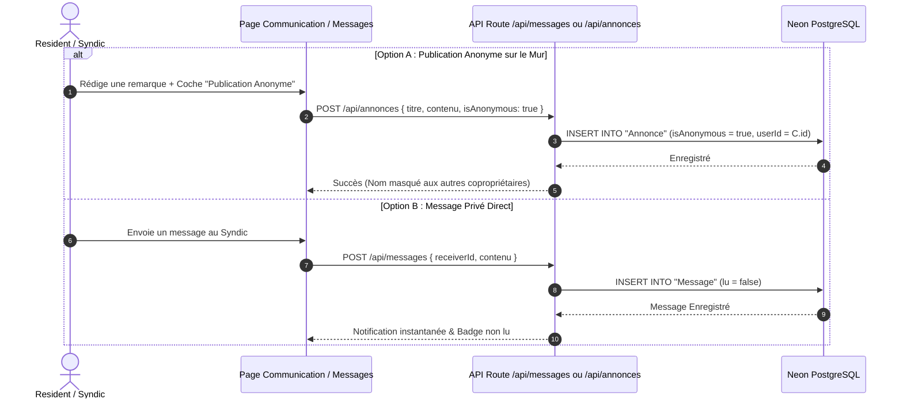

---

## 🪟 CONCLUSION ET PERSPECTIVES D'ÉVOLUTION

---

### 5.1 Bilan Général du Projet & Apports du Stage

Le stage effectué au sein du pôle ingénierie logicielle de **CAD Digital Agency** a constitué une opportunité exceptionnelle de mettre en pratique les compétences théoriques et techniques acquises durant mon cursus d'Ingénierie des Logiciels et Intelligence Artificielle à l'**ENSA Fès**.

La plateforme **SyndicApp** développée répond concrètement à la problématique initiale de la gestion de copropriété au Maroc (encadrée par la Loi 18-00 / 106-12). L'ensemble des 17 cas d'utilisation spécifiés (**CU-01 à CU-17**) ont été implémentés avec succès et validés sous **TypeScript** (0 erreur de compilation).

---

### 5.2 Perspectives d'Évolution Fonctionnelles & Métiers

Pour pérenniser la plateforme et accompagner la croissance des résidences gérées par les syndics au Maroc, plusieurs axes d'évolution fonctionnelle sont envisagés à court et moyen terme :

#### 5.2.1 Intégration du Paiement en Ligne Direct (Passerelle CMI / Stripe / PayPal)
- Permettre aux copropriétaires de régler leurs cotisations mensuelles directement depuis leur smartphone par carte bancaire marocaine (via la passerelle **CMI - Centre Monétique Interbancaire**) ou internationale.
- Génération et transmission automatique de la quittance de caisse certifiée en PDF dès la validation effective de la transaction bancaire, éliminant toute saisie manuelle par le syndic.

#### 5.2.2 Module d'Intelligence Artificielle & Analyse Prédictive des Impayés
- Implémentation d'un algorithme de Machine Learning (Scikit-Learn / FastAPI) pour analyser l'historique des règlements et prédire le risque de retard de paiement par lot.
- Génération automatique de recommandations personnalisées pour le syndic (échéanciers de rééchelonnement, relances ciblées).

#### 5.2.3 Numérisation et Reconnaissance Optique des Factures (OCR)
- Permettre au syndic d'uploader la photo d'une facture de travaux exceptionnels depuis son smartphone.
- Extraction automatique du montant, du nom du fournisseur et de la date par OCR (Optical Character Recognition) afin d'alimenter directement le calculateur de ventilation des dépenses d'urgence.

---

### 5.3 Perspectives d'Évolution Techniques & Architecturales

#### 5.3.1 Développement d'une Application Mobile Native Cross-Platform (React Native)
- Déploiement d'une application mobile dédiée sous iOS et Android développée avec **React Native / Expo**.
- Envoi de **Notifications Push** en temps réel pour alerter les copropriétaires lors du lancement d'un sondage obligatoire, de la publication d'un avis d'urgence ou de l'arrivée d'une quittance.

#### 5.3.2 Automates d'Envoi WhatsApp Business & SMS (API Twilio / Meta)
- Intégration de l'API **WhatsApp Business** pour l'envoi automatique de rappels d'échéances et de notifications de nouveaux messages directement sur le smartphone des résidents.

#### 5.3.3 Intégration IoT & Bâtiment Intelligent (Smart Building)
- Connexion aux compteurs d'eau et d'électricité des parties communes via des capteurs **IoT** (LoRaWAN / MQTT) pour un suivi automatisé de la consommation et une détection instantanée des fuites.

---

### 📊 5.4 Feuille de Route & Feuille d'Orientation (Roadmap d'Évolution)

| Axe d'Évolution | Périmètre & Description | Stack & Technologies Cibles | Horizon Temporel |
|---|---|---|---|
| **Paiement Direct CMI** | Règlement par Carte Bancaire en ligne | CMI Gateway / Stripe Webhooks | Court terme (3 mois) |
| **Notifications WhatsApp** | Relances automatiques d'échéances | API WhatsApp Business / Twilio | Court terme (3 mois) |
| **Application Mobile Native** | Version iOS & Android native | React Native / Expo / Firebase | Moyen terme (6 mois) |
| **OCR Factures & Reçus** | Extraction automatique des données | Tesseract OCR / OpenAI Vision | Moyen terme (6 mois) |
| **IA & Scoring Impayés** | Prédiction des risques de paiement | Python / FastAPI / Scikit-Learn | Long terme (12 mois) |
| **IoT Communs** | Télé-relevé des compteurs d'eau/élec | Capteurs MQTT / LoRaWAN | Long terme (12 mois) |
